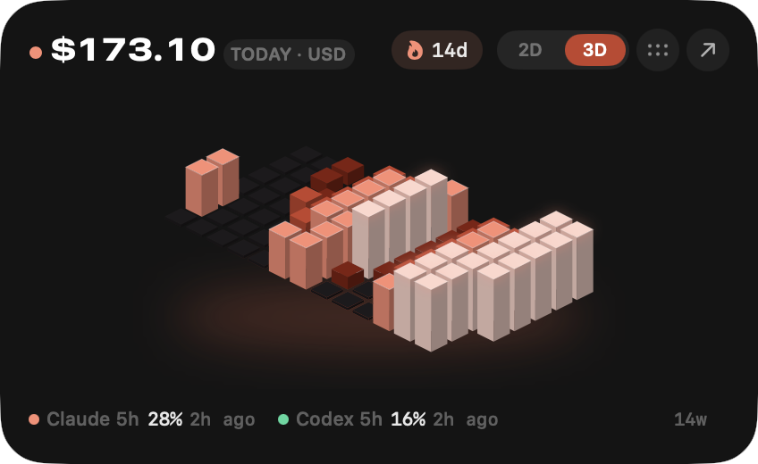
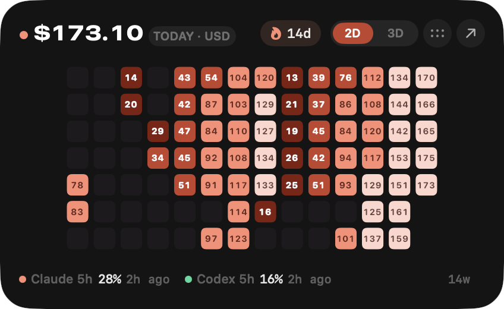
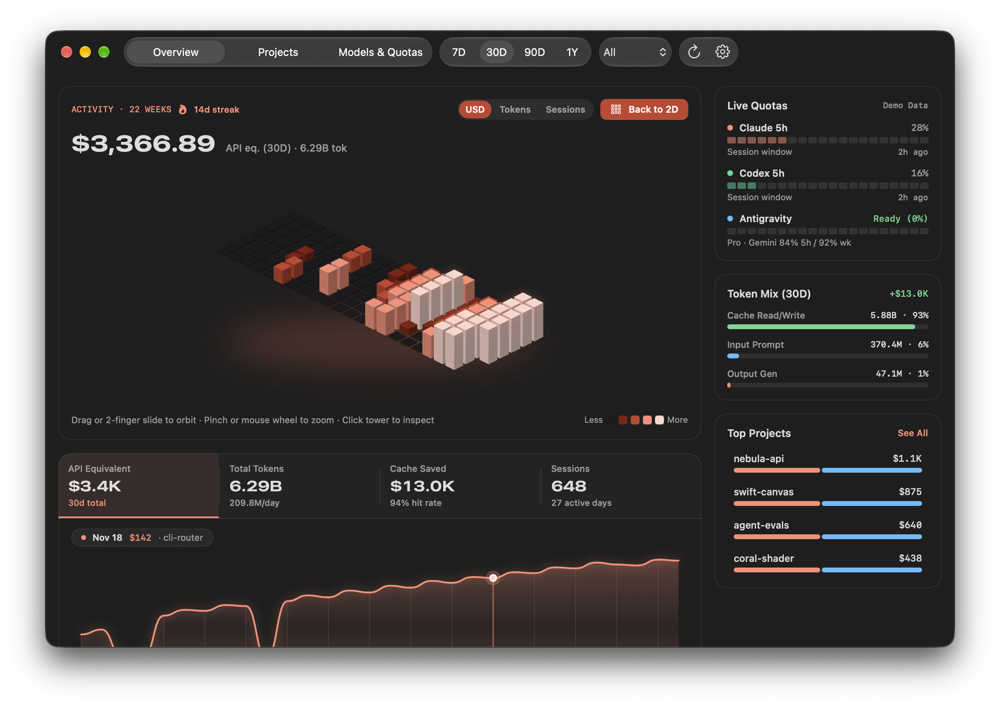

<div align="center">
  
  <h1>Milkit</h1>
  <p>
    See how hard you're milking your AI coding subscriptions. A macOS desktop widget that turns your real API-equivalent burn into a live 2D/3D coral skyline right on your wallpaper — <strong>$20/mo in, thousands of dollars of their GPUs out</strong>.
  </p>
  <p>
    <a href="https://github.com/stankela16/milkit/actions/workflows/ci.yml"></a>
    <a href="LICENSE"></a>
    
    
  </p>
</div>

<div align="center">
  <table>
    <tr>
      <td align="center" width="50%">
        <br />
        <sub><strong>3D Desktop Widget</strong> — isometric coral skyline &amp; live passive quotas</sub>
      </td>
      <td align="center" width="50%">
        <br />
        <sub><strong>2D Desktop Widget</strong> — calendar heatmap with adaptive KPI micro-labels</sub>
      </td>
    </tr>
  </table>
</div>

<p align="center">
  <br />
  <sub><strong>Analytics Dashboard (<code>⌃⌥T</code>)</strong> — interactive 3D orbit/zoom, live quotas, token mix, top projects &amp; velocity spline</sub>
</p>

## Highlights

- **Native macOS Desktop Widget**: Liquid Glass (`NSGlassEffectView` on macOS 26+, frosted `NSVisualEffectView` fallback on macOS 15 Sequoia), pinned to your desktop plane, fluidly resizable (`340×220` to `720×460`), with hold-to-drag positioning and Menu Bar quick controls.
- **Interactive 2D ↔ 3D Coral Heatmap**:
  - Continuous 3D camera-tilt morph between crisp 2D calendar squares (with Skyscanner-style adaptive KPI micro-labels) and a `~29°` isometric 3D tower skyline.
  - **Sticky 3D Orbit & Focal-Point Zoom** (`65%–260%`): orbit freely with 2-finger trackpad slide or mouse drag, zoom with trackpad pinch, mouse wheel, or `⌘/⌥ + Scroll`, pan with `⇧ + Drag`, and reset with `↺ Reset` or double-click.
  - Floating hover callout pill above every tower and subtle modal-acoustic UI sound effects (toggleable in Settings).
- **Analytics Dashboard (`⌃⌥T`)**: Overview velocity spline chart, Projects breakdown table, Models & Quotas table, provider filtering, and day-by-day drill-down.
- **Demo Mode (`--demo`)**: Launch with `--demo` or toggle in Settings to preview realistic anonymized 36-week activity data for screenshots, videos, or testing without exposing personal project names.
- **Zero-Lag & Privacy-First**: Read-only incremental SQLite & C-streamed JSONL ingestion (`~2 MB` peak parser RAM) driven by kernel `FSEvents`. Never sends data over the network and never writes into third-party tool databases.

## Supported Local AI Tools

| Tool | Local Data Path | What Is Tracked |
|---|---|---|
| **Claude Code** | `~/.claude/projects/**/*.jsonl` (`$CLAUDE_CONFIG_DIR`) & `~/.claude.json` | Input/output tokens, 5m & 1h cache writes, cache reads & savings, subagent attribution, sessions, passive 5h/7d quotas |
| **OpenAI Codex CLI** | `~/.codex/sessions/**/rollout-*.jsonl` (`$CODEX_HOME`) | Input/cached/output tokens, model breakdown, sessions, passive rate-limit quotas |
| **Google Antigravity** | `~/.gemini/antigravity/` & `~/AntigravityProfiles/` | Token usage, project mapping, model breakdown, optional passive quota caches |

## Download & Install

- **Requires macOS 15.0 (Sequoia)** or later (macOS 26+ recommended for native Liquid Glass).
- Download **`Milkit-1.0.0.dmg`** (~2.8 MB) from the [Latest Release](https://github.com/stankela16/milkit/releases/latest) and drag **Milkit** into **Applications**.

> **First launch (ad-hoc signed open-source build):** Because this build is not Apple-notarized, macOS Gatekeeper may block the first launch. Run this once in Terminal:
> ```bash
> xattr -dr com.apple.quarantine "/Applications/Milkit.app"
> ```
> Or try launching the app once, then open **System Settings → Privacy & Security** and click **Open Anyway**.

## Build & Run from Source

Requires **Xcode 16+** (Swift 6.0), and optionally [XcodeGen](https://github.com/yonaskolb/XcodeGen) (`brew install xcodegen`) if regenerating the `.xcodeproj` from `project.yml`.

```bash
git clone https://github.com/stankela16/milkit.git
cd milkit

# Optional: regenerate Xcode project after editing project.yml
xcodegen generate

# Run unit tests
xcodebuild test -project Milkit.xcodeproj -scheme Milkit -destination 'platform=macOS'

# Build Release app (ad-hoc signed, no Apple Developer account required)
xcodebuild build -project Milkit.xcodeproj -scheme Milkit -configuration Release -destination 'platform=macOS' -derivedDataPath build/DerivedData

# Launch
open build/DerivedData/Build/Products/Release/Milkit.app

# Or launch directly in Demo Mode (safe for screenshots & videos)
open build/DerivedData/Build/Products/Release/Milkit.app --args --demo
```

## Keyboard Shortcuts

| Shortcut | Action |
|---|---|
| `⌃⌥T` | Open Analytics Dashboard (global hotkey, no Accessibility permission required) |
| `⌘1` / `⌘2` / `⌘3` | Switch Dashboard tabs (Overview / Projects / Models & Quotas) |
| `⌘D` | Toggle Dashboard 2D ↔ 3D heatmap |
| `⌘⌥D` | Toggle Desktop Widget 2D ↔ 3D heatmap |
| `⌘R` | Refresh local sources |
| `⌘,` | Open Settings |

## Architecture

- **Swift 6.0** (`SWIFT_STRICT_CONCURRENCY = complete`), zero external Swift packages, linked only against Apple system frameworks + `libsqlite3`.
- **Safe Read-Only SQLite (`SafeReadOnlySQLite`)**: Never modifies foreign WAL databases (`SQLITE_OPEN_READONLY`, immutable mode for cold DBs, temp-copy fallback for orphan WALs).
- **Local Rollup Cache**: Stored in `~/Library/Application Support/Milkit/usage_rollup.sqlite` for instant `< 1 ms` startup and monotonic deduplication.

## Contributing & Security

- See [CONTRIBUTING.md](CONTRIBUTING.md) for local signing overrides (`LocalSigning.xcconfig`), architecture rules, and PR guidelines.
- See [SECURITY.md](SECURITY.md) for our 100% offline/read-only privacy guarantees and vulnerability reporting.

## License

[MIT](LICENSE)
